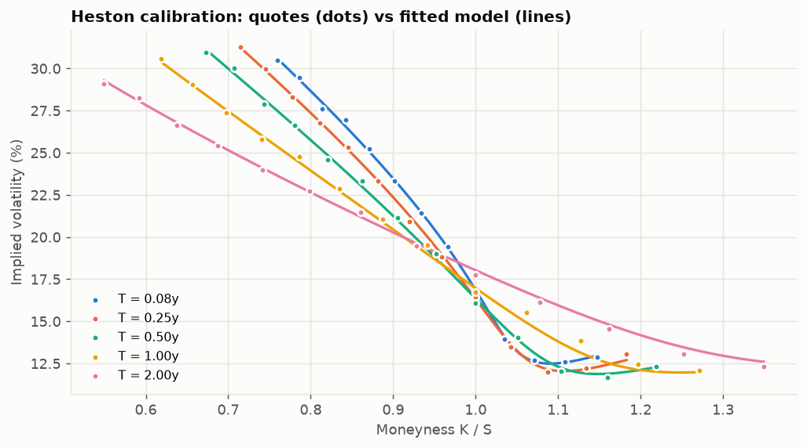
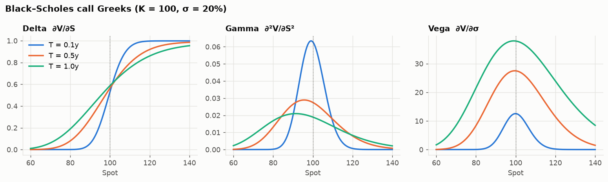
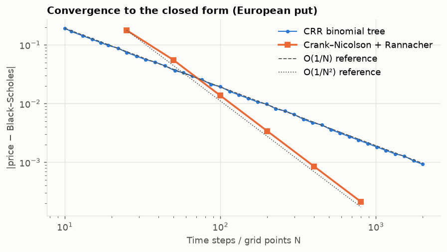
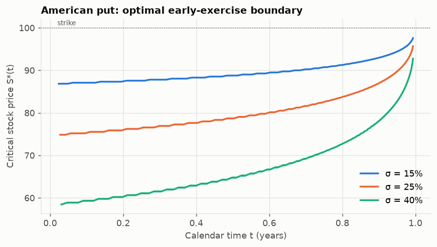
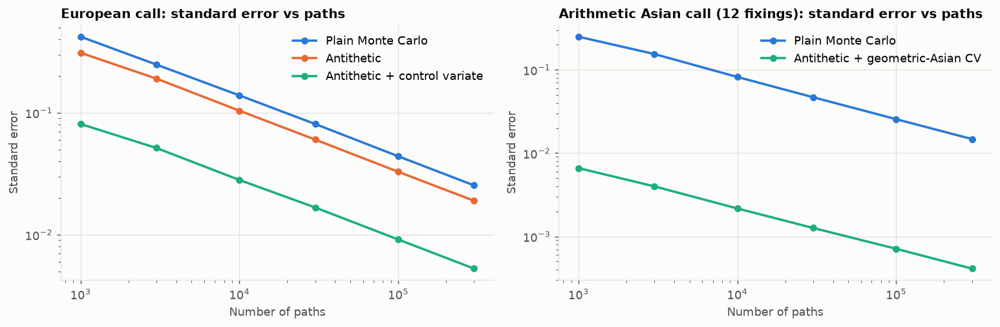
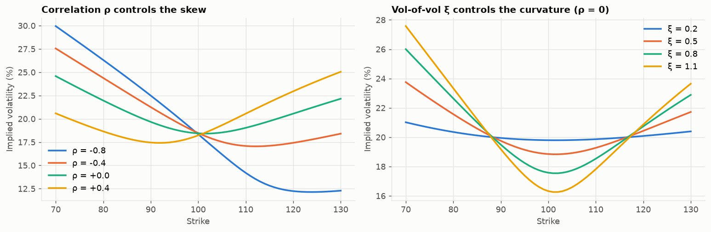

# Option pricing engine

[](https://github.com/didargumus/option-pricing-engine/actions/workflows/tests.yml)


A derivatives pricing library I wrote from scratch in Python and NumPy. It has closed-form prices, binomial trees, a finite-difference PDE solver and Monte Carlo simulation, plus the Heston stochastic-volatility model with calibration to an implied-volatility surface.

Each method is checked against something independent of it. Usually that is a closed form or a second numerical method; for Heston it is [QuantLib](https://www.quantlib.org/). The checks are a 35-test pytest suite that runs on every push.

<p align="center"></p>

## Results at a glance

| Area | Result |
|---|---|
| Heston pricer | Matches QuantLib's `AnalyticHestonEngine` to 3 × 10⁻¹¹ and prices 1,000 strikes in about 10 ms |
| Heston calibration | Recovers the true parameters from a noisy 65-quote surface in 0.2 s (fit RMSE 24.5 bp, injected noise 25 bp) |
| Variance reduction | A geometric-Asian control variate cuts Monte Carlo variance about 1,300 times for arithmetic Asian options |
| American options | A CRR tree and a Crank–Nicolson solver (Brennan–Schwartz) agree to 7 × 10⁻⁴ |
| Implied volatility | 1,000 vols in about 25 ms, round-trip error below 10⁻¹² |

## Modules

| Module | Contents |
|---|---|
| [`black_scholes.py`](src/optionpricer/black_scholes.py) | Black–Scholes–Merton prices with a dividend yield; analytic Greeks (delta, gamma, vega, theta, rho, vanna, volga) |
| [`binomial.py`](src/optionpricer/binomial.py) | Cox–Ross–Rubinstein tree for European and American options, and the early-exercise boundary |
| [`finite_difference.py`](src/optionpricer/finite_difference.py) | Crank–Nicolson in log-price with Rannacher smoothing; Brennan–Schwartz solve for American options |
| [`monte_carlo.py`](src/optionpricer/monte_carlo.py) | Exact GBM simulation, antithetic and control variates, arithmetic Asian options, barrier options with the Broadie–Glasserman–Kou correction |
| [`heston.py`](src/optionpricer/heston.py) | Characteristic function in the "little Heston trap" form, Gil-Pelaez pricing, full-truncation Monte Carlo, calibration |
| [`implied_vol.py`](src/optionpricer/implied_vol.py) | Vectorised implied-volatility solver (Newton with a bisection fallback) |
| [`market_data.py`](src/optionpricer/market_data.py) | Optional. Downloads a live option chain with yfinance, cleans the quotes and builds the IV surface |

## Quick start

```bash
git clone https://github.com/didargumus/option-pricing-engine.git
cd option-pricing-engine
pip install -e ".[dev]"
pytest                          # test suite
python examples/quickstart.py   # short tour of the library
python scripts/make_figures.py  # regenerates the figures and docs/benchmarks.md
```

```python
from optionpricer import HestonParams, heston_price, implied_vol, crr_price

p = HestonParams(kappa=2.0, theta=0.04, xi=0.6, rho=-0.7, v0=0.04)
price = heston_price(S=100, K=[90, 100, 110], T=1.0, r=0.05, p=p, q=0.02)
vols  = implied_vol(price, 100, [90, 100, 110], 1.0, 0.05, 0.02)      # skewed smile

american_put = crr_price(100, 100, 1.0, 0.05, 0.2, 0.02, option="put", american=True, steps=2000)
```

## Methods and results

### 1. Black–Scholes and the Greeks

$$
C = S e^{-qT}N(d_1) - K e^{-rT}N(d_2), \qquad d_{1,2} = \frac{\ln(S/K) + (r - q \pm \tfrac12\sigma^2)T}{\sigma\sqrt T}
$$

The Greeks are analytic. The tests compare them with central finite differences at a relative tolerance of 10⁻⁶.



### 2. Trees and the PDE solver

The CRR tree converges at first order, O(1/N). Crank–Nicolson is second order in space and time, O(1/N²), but in its plain form it oscillates near the kink in the payoff. I start the solver with a few fully implicit half-steps (Rannacher smoothing), and the plot below shows the O(1/N²) rate that results.

For American options the solver has to satisfy $\max(\mathcal{L}V, \text{payoff} - V) = 0$ at every time step. The Brennan–Schwartz algorithm does this exactly: it is a Thomas-type tridiagonal solve that applies the early-exercise constraint during back-substitution.



The tree also gives the early-exercise boundary $S^*(t)$ of the American put. When volatility is higher, keeping the option alive is worth more, so the boundary moves down.



### 3. Monte Carlo and variance reduction

Every estimator reports a standard error next to its price. With antithetic sampling the standard error is computed over pairs of paths, since the pair is the independent unit. Control-variate coefficients $\beta^* = \operatorname{Cov}(Y,X)/\operatorname{Var}(X)$ are estimated from the same sample.

| Estimator (100,000 paths) | Std. error | Variance reduction |
|---|---:|---:|
| European call, plain | 0.0440 | 1× |
| European call, antithetic | 0.0328 | 2× |
| European call, antithetic + terminal-stock control variate | 0.0091 | 23× |
| Arithmetic Asian, plain | 0.0256 | 1× |
| Arithmetic Asian, antithetic + geometric-Asian control variate | 0.0007 | 1,295× |

The geometric-average Asian option has a closed-form price, because the log of a geometric average of lognormals is normal (Kemna and Vorst 1990). Its payoff moves almost one for one with the arithmetic payoff, which is why it works so well as a control.



For barrier options, a discretely monitored down-and-out call is simulated and compared with the continuous-monitoring formula, with the barrier shifted by $e^{-0.5826\,\sigma\sqrt{\Delta t}}$ (Broadie, Glasserman and Kou 1997).

### 4. The Heston model

$$
dS_t = (r-q)S_t\,dt + \sqrt{v_t}\,S_t\,dW^S_t,\qquad
dv_t = \kappa(\theta - v_t)\,dt + \xi\sqrt{v_t}\,dW^v_t,\qquad
d\langle W^S,W^v\rangle_t=\rho\,dt
$$

Heston's original characteristic function has a complex logarithm that can jump across a branch cut for long maturities. I use the rearranged "little Heston trap" form (Albrecher et al. 2007), which avoids this. Prices come from Gil-Pelaez inversion with 256-point Gauss–Legendre quadrature, vectorised across strikes.

The pricer agrees with QuantLib to 10⁻¹⁰. It also agrees with a full-truncation Euler Monte Carlo (within the confidence interval) and with Black–Scholes as ξ goes to 0.

In the figure, a negative ρ (the leverage effect) produces the equity skew, and ξ sets how curved the smile is.



### 5. Calibration

The parameters $(\kappa,\theta,\xi,\rho,v_0)$ are fitted with bounded trust-region least squares (`scipy.optimize.least_squares`, TRF). The residuals are price errors divided by vega, $(C^{model}-C^{mkt})/\mathcal{V}$. To first order this equals the implied-vol error, and it avoids inverting Black–Scholes inside the optimiser. Only out-of-the-money options are used, since those are the liquid ones.

The test surface has 5 maturities and 13 strikes per maturity. I generated it from known parameters and added 25 bp of Gaussian noise to the vols to imitate bid/ask scatter.

| Parameter | True | Calibrated |
|---|---:|---:|
| κ (mean reversion) | 1.800 | 1.751 |
| θ (long-run variance) | 0.0450 | 0.0453 |
| ξ (vol of vol) | 0.750 | 0.744 |
| ρ (correlation) | −0.750 | −0.745 |
| v₀ (initial variance) | 0.0300 | 0.0301 |

The fit's IV RMSE is 24.5 bp, about the same as the noise, so the model fits the signal and is not chasing the noise. On noise-free data the parameters come back essentially exactly (see `examples/quickstart.py`), and a test checks this.

The calibration figure uses this synthetic surface. To run it on real quotes, `optionpricer.market_data.fetch_iv_surface("SPY")` downloads an option chain, filters it by open interest, bid-ask width and moneyness, and returns an OTM surface that `calibrate_heston` accepts. It needs `pip install ".[data]"`.

Full accuracy and timing tables are in [`docs/benchmarks.md`](docs/benchmarks.md).

## Testing

```
tests/test_pricing.py ...................................   35 passed
```

The suite checks:

* textbook values (Hull, Example 15.6) and put-call parity
* analytic Greeks against finite differences
* convergence of the CRR tree and Crank–Nicolson to Black–Scholes
* American prices against European ones (the American put is worth more; without dividends the American call equals the European call)
* that every Monte Carlo estimate falls within 4 standard errors of the true price, and that variance reduction lowers the error
* implied-vol round trips over 33 strikes, 3 maturities and 3 volatility levels, and rejection of prices that violate no-arbitrage bounds
* Heston against QuantLib, Monte Carlo, the Black–Scholes limit and put-call parity, plus the skew sign and parameter recovery in calibration

## Project structure

```
option-pricing-engine/
├── src/optionpricer/      # library
├── tests/                 # pytest suite
├── examples/quickstart.py
├── scripts/make_figures.py
├── docs/figures/          # generated plots
├── docs/benchmarks.md     # generated accuracy and timing tables
└── .github/workflows/     # CI: lint and tests on Python 3.10, 3.11, 3.12
```

## References

1. Black, F. and Scholes, M. (1973). The Pricing of Options and Corporate Liabilities. *Journal of Political Economy*.
2. Cox, J., Ross, S. and Rubinstein, M. (1979). Option Pricing: A Simplified Approach. *Journal of Financial Economics*.
3. Heston, S. (1993). A Closed-Form Solution for Options with Stochastic Volatility. *Review of Financial Studies*.
4. Albrecher, H., Mayer, P., Schoutens, W. and Tistaert, J. (2007). The Little Heston Trap. *Wilmott Magazine*.
5. Brennan, M. and Schwartz, E. (1977). The Valuation of American Put Options. *Journal of Finance*.
6. Rannacher, R. (1984). Finite element solution of diffusion problems with irregular data. *Numerische Mathematik*.
7. Kemna, A. and Vorst, A. (1990). A Pricing Method for Options Based on Average Asset Values. *Journal of Banking & Finance*.
8. Broadie, M., Glasserman, P. and Kou, S. (1997). A Continuity Correction for Discrete Barrier Options. *Mathematical Finance*.
9. Lord, R., Koekkoek, R. and van Dijk, D. (2010). A Comparison of Biased Simulation Schemes for Stochastic Volatility Models. *Quantitative Finance*.
10. Glasserman, P. (2003). *Monte Carlo Methods in Financial Engineering*. Springer.

## License

MIT. See [LICENSE](LICENSE).
